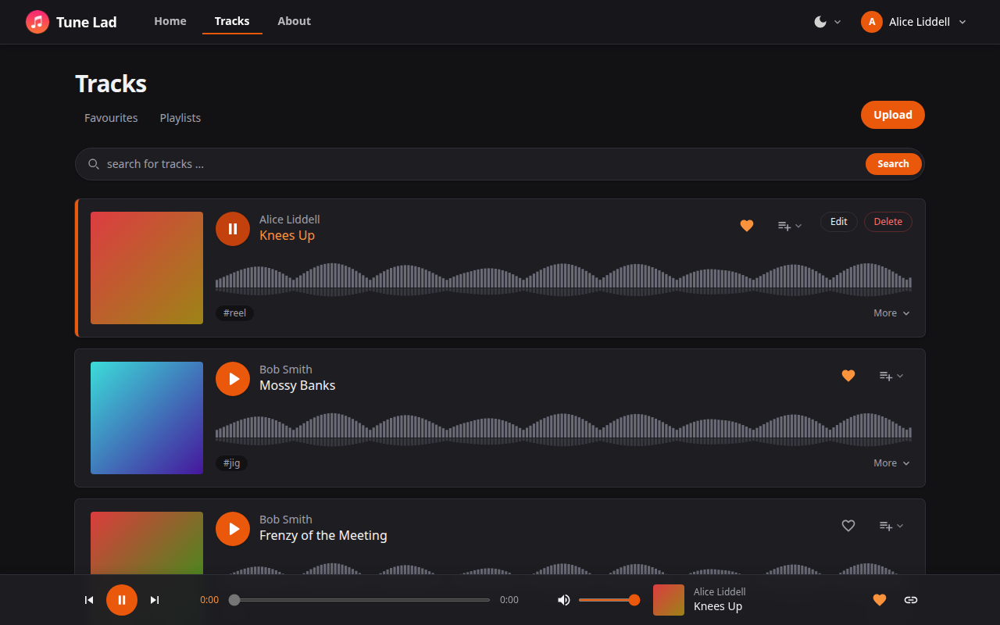
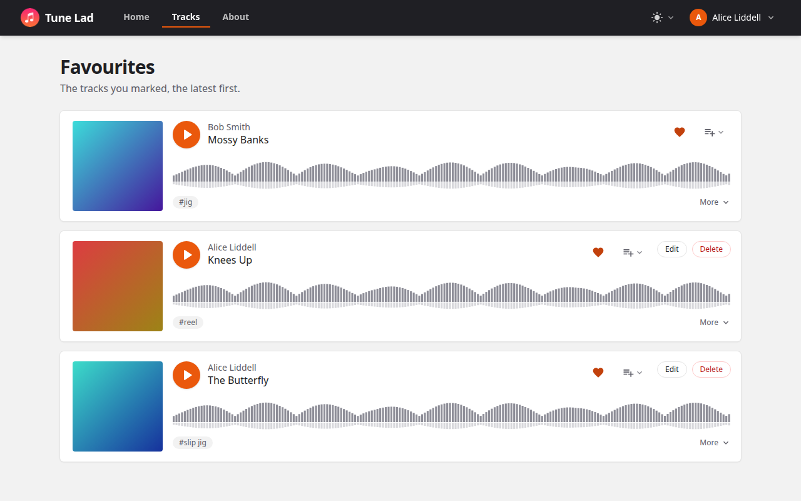
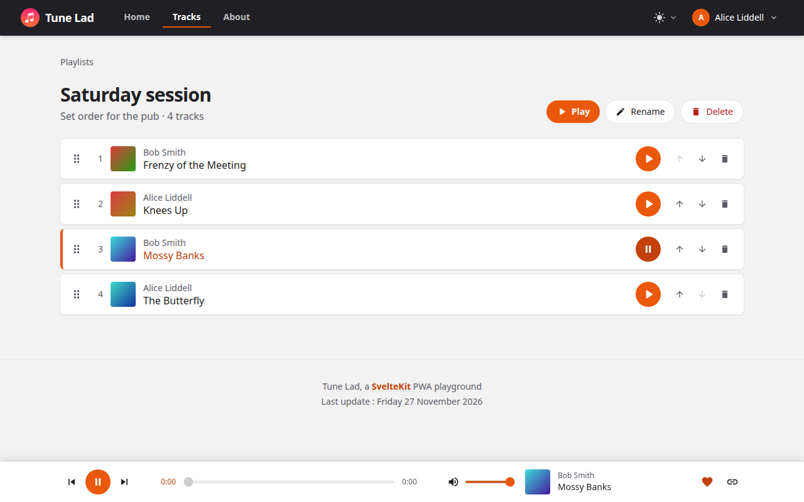
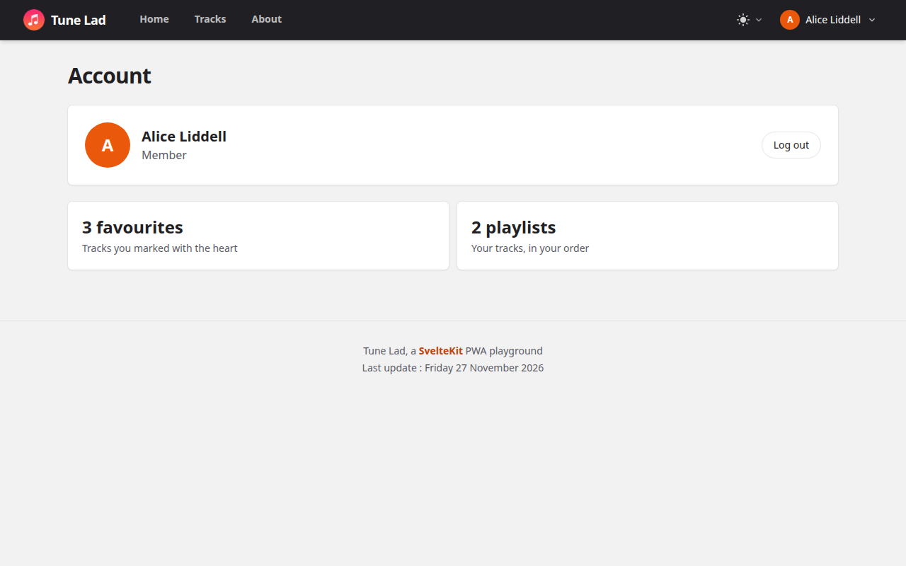

= Tune Lad (playground)
//:doctype: book
:sectnums:
//:source-highlighter: highlightjs
:idprefix:
:idseparator: -
:sectlinks:
:sectanchors:
//:linkcss: false
:allow-uri-read:
// :imagesdir: ./doc/images

:icon-party: &#x1F973;

ifndef::env-github[:icons: font]
ifdef::env-github[]
:status:
:outfilesuffix: .adoc
:caution-caption: :fire:
:important-caption: :exclamation:
:note-caption: :paperclip:
:tip-caption: :bulb:
:warning-caption: :warning:
endif::[]
// Vars
:project-group-id: org.tunelad
:project-artifact-id: tunelad
:project-version: 0.0.1-SNAPSHOT
:orga: uguy
:uri-org: https://github.com/{orga}
:uri-repo: {uri-org}/{project-artifact-id}
:uri-issues: {uri-repo}/issues
:uri-contributors: {uri-repo}/graphs/contributor
:uri-rel-file-base: link:
:uri-rel-tree-base: link:
ifdef::env-site,env-yard[]
:uri-rel-file-base: {uri-repo}/blob/master/
:uri-rel-tree-base: {uri-repo}/tree/master/
endif::[]
:uri-changelog: {uri-rel-file-base}CHANGELOG.adoc
:uri-contribute: {uri-rel-file-base}CONTRIBUTING.adoc
:uri-license: {uri-rel-file-base}LICENSE

image::./app/static/images/icon-144x144.png[Tune Lad,link="{uri-repo}",width=200px,role=related thumb right]

ifdef::status[]
image:{uri-repo}/actions/workflows/workflow-build.yml/badge.svg?branch=main[Build,link="{uri-repo}/actions?query=workflow%3Aworkflow-build+branch%3Amain"]
image:https://img.shields.io/badge/License-GPL%20v3-yellow.svg[License,link="{uri-license}"]
endif::[]

Dummy project used as a playground for things like https://docs.spring.io/spring-modulith/docs/current/reference/html/[Spring Modulith], https://docs.spring.io/spring-framework/docs/current/reference/html/web-reactive.html[WebFlux], https://swagger.io/specification/[OpenAPI], https://kit.svelte.dev/docs/introduction[SvelteKit], https://tailwindcss.com/[Tailwind CSS], etc.

This simple app allows to store an mp3 file with some description and play it via the browser `<audio>` html element.

'''

== Features

* Light and dark themes in the orange and charcoal palette: the operating system's theme by default, a switch in the header
  to force one (remembered in the browser), no flash of the wrong theme on load
* Log in with an OpenID Connect provider (Keycloak locally, Google optional); API clients use bearer access tokens; an
  account page shows who you are, your role and the size of your collections
* Upload a track from the UI or the API (mp3, m4a, ogg, flac or wav, up to 100 MB; requires login or a bearer token), with progress, cancel and retry; every track shows who uploaded it. A track records a set (chosen or built on the upload form, `setId` in the API) and has one performance per tune of it, with its start offset, key and notes, shown in the track's details and editable by its owner. Tracks stored before sets existed have none
* Owners edit and delete their own tracks, and administrators (Keycloak `admin` role) any track, from the API or the track list
* List tracks and search them by words in title or description (a new upload becomes searchable within a few seconds)
* Play track from browser (streaming bytes with range support, so the player can seek), in a player bar that stays
  at the bottom of the screen across pages: play/pause, previous/next through the track list, seeking, volume and
  mute (remembered between visits)
* Track waveforms: computed with ffmpeg shortly after upload (and backfilled at startup for older tracks), served on
  `GET /api/tracks/{id}/waveform`, and drawn on each track of the list, where a click seeks within the track
* Live updates: the track list and the waveforms refresh by themselves when another user uploads, edits or deletes a
  track and when a waveform is computed, and your favourites and playlists follow what you change in your other tabs
  and devices (they are private: only your own connections hear of them), with no reload and no polling. The server streams them as Server-Sent Events
  (`GET /api/live`), through https://nats.io[NATS] so that every running instance of the application reaches its own
  browsers
* Tunes: a shared collection of traditional tunes with their dance type (`/tunes`, `GET /api/tunes`), created by hand or imported
  from thesession.org by id (`POST /api/tunes/import`). A tune's page shows its reference transcription as sheet music or as ABC
  text, and plays it as flute audio synthesized in the browser (abcjs, loaded only on that page; the flute samples are served by the
  app, one file per note, and fetched as needed)
* Sets: ordered lists of tunes, one shared set per distinct ordered list (`/sets`, `GET /api/sets`). A set is built from the tunes page
  list with add, move up or down and remove buttons, and `POST /api/sets` answers with the existing set when the list has one already
* Favourites: a heart on every track (list and player bar) for logged-in users, and a page that lists them
  (`/tracks/favourites`, `GET /api/me/favourites`)
* Playlists: private ordered lists of tracks, created, renamed and deleted from `/tracks/playlists`. Add a track from the
  list with the _Add to playlist_ button, reorder a playlist by drag and drop (or with the _Move up_ and _Move down_
  buttons, for keyboard and touch), and play it from the start, the player moving on to the next track
* Share a link that starts a track at a given time (`/tracks?play=<id>&t=<seconds>`)
* OpenAPI v3 endpoint
* Spring boot actuator features (health, info, etc.)
* Traces, metrics and logs exported with OpenTelemetry, to a local Grafana stack (Tempo, Loki, Prometheus) that `docker compose up -d` starts
* Mobile friendly
* PWA support
* Lighthouse score follow up

== Developing

=== Prerequisite

- a git client
- a java (jdk25 or later)
- maven (optional if you choose to use https://github.com/takari/maven-wrapper[maven wrapper script])
- Docker and Docker Compose
- Bun v1.4 or later
- https://ffmpeg.org[ffmpeg] on the `PATH` (check with `ffmpeg -version`; e.g. `sudo apt install ffmpeg`), to compute
  track waveforms. The backend tests need it. Without it the app still runs, but waveforms stay pending until it is
  installed and the app restarted. Another location can be set with `tunelad.media.ffmpeg.path`.

=== Building

==== Backend

This is a standard maven project. To build the application as fat jar, simply execute:

[source,bash,subs="attributes"]
----
git clone {uri-repo}.git
cd {project-artifact-id}/
./mvnw package
----

The build should produce under the `target/` folder (and in your local maven repository) a jar archive named `{project-artifact-id}-{project-version}.jar`

For more details about apache maven, please refer to the https://maven.apache.org/guides/getting-started/[documentation]

==== Tests

`./mvnw clean verify` runs every test: the Java tests (Testcontainers, so Docker must be running), the frontend unit tests (vitest) in the `test` phase, and the Playwright e2e tests in the `integration-test` phase.
The e2e tests run against the static frontend build with the REST API mocked, so they need neither the backend nor PostgreSQL.
The first build downloads Chromium for Playwright (cached in `~/.cache/ms-playwright`).

Use the usual maven flags to skip tests:

[source,bash]
----
./mvnw verify -DskipITs    # skip the frontend e2e tests only
./mvnw verify -DskipTests  # skip all Java and frontend tests
----

From the `app/` folder, `bun run test:unit` and `bun run test:e2e` run each frontend suite on its own.

==== Frontend

The frontend source code lives in `<project root>/app` folder.

Svelte frontend is build during maven backend build but if your want livereload for UI development this command will run the frontend app in dev mode.

[source,bash,subs="attributes"]
----
bun run dev -- --open
----

You should format frontend resource by running the following command (todo: make this a git commit hook).

[source,bash,subs="attributes"]
----
bun run format
----

== Running the application

=== Prerequisite

The application depends on PostgreSQL, and uses NATS for live updates. You can start both by running docker compose
from the root folder.

[source,bash,subs="attributes"]
----
docker compose up -d
----

PostgreSQL starts empty and Liquibase creates the schema when the application starts, so there is nothing to
set up. `docker compose up -d --wait` returns once the database is ready.

Adminer (a PostgreSQL web UI) should be available at http://localhost:8081 (server `postgres`, user, password and
database `tunelad`).

=== NATS (live updates)

Live updates travel between instances of the application through NATS (core, with no persistence): `docker compose up -d`
starts it on `nats://localhost:4222`, which is the default of `tunelad.live.nats.url`. Without it the application still
starts and works, but the track list, waveforms, favourites and playlists only refresh on reload, until NATS is reachable again (no restart
needed).

=== Keycloak (local login)

Users log in through an OpenID Connect provider. Locally, Keycloak stands in for Google and friends: `docker compose up -d`
starts it on http://localhost:8180 and imports the `tunelad` realm from `docker/keycloak/tunelad-realm.json`.
The application needs Keycloak running to start, because it reads the provider's configuration at startup.

[cols="1,1,2"]
|===
|User |Password |Display name

|`alice` |`alice` |Alice Liddell
|`bob` |`bob` |Bob Smith
|`admin` |`admin` |Tune Lad Admin, with the realm role `admin`: may edit and delete any track
|===

The realm puts its realm roles in a `roles` claim of the tokens, and the application treats a user holding the `admin`
role as an administrator (`GET /api/me` answers `"admin": true`).

The Keycloak admin console is at http://localhost:8180/admin (`admin`/`admin`). That `admin` is Keycloak's own
administrator in the `master` realm, unrelated to the `admin` user of the `tunelad` realm who logs in to the app.

Keycloak imports the realm only when it doesn't exist yet. After changing `docker/keycloak/tunelad-realm.json` (or
pulling a change to it), recreate the container to import it again (Keycloak keeps its data inside the container):

[source,bash]
----
docker compose up -d --force-recreate keycloak
----

WARNING: The realm is for local development only: the `tunelad` client secret (`tunelad-dev-secret`) is committed, and
direct access grants are enabled so that curl and tests can get tokens with a username and password.

Log in from the browser at http://localhost:8080/login, which lists the configured providers, also available as JSON from `GET /api/login-providers`.

To also offer Google, create an OAuth client in the Google Cloud console with the authorized redirect URI
`http://localhost:8080/login/oauth2/code/google`, then run the application with the `google` profile and the client's
credentials:

[source,bash]
----
GOOGLE_CLIENT_ID=... GOOGLE_CLIENT_SECRET=... ./mvnw spring-boot:run -Dspring-boot.run.profiles=google
----

The same person logging in through Keycloak and through Google gets two separate accounts.

To check that the realm is up and get an access token for alice:

[source,bash]
----
curl -s http://localhost:8180/realms/tunelad/.well-known/openid-configuration
curl -s -d grant_type=password -d client_id=tunelad -d client_secret=tunelad-dev-secret \
  -d username=alice -d password=alice http://localhost:8180/realms/tunelad/protocol/openid-connect/token
----

To wipe the local data (tracks, audio and search index) and start from an empty database, remove the containers
together with their volumes:

[source,bash,subs="attributes"]
----
docker compose down -v
----

NOTE: Every track has an owner since user accounts were added. Tracks stored by an earlier version have none and are
not migrated: wipe the local data once when upgrading past that change.

=== Observability (traces, metrics, logs)

The application exports its traces, metrics and logs with OpenTelemetry, over OTLP/HTTP to `http://localhost:4318`.
`docker compose up -d` starts a local stack to look at them, all on the compose network:

[cols="2,3,5"]
|===
|Service |Reachable at |Role

|OpenTelemetry Collector
|OTLP on `localhost:4318` (HTTP) and `localhost:4317` (gRPC)
|The only door in: the application sends everything here, and it forwards traces to Tempo, logs to Loki and metrics to Prometheus

|Tempo
|inside the compose network only
|Traces

|Loki
|inside the compose network only
|Logs

|Prometheus
|http://localhost:9090
|Metrics, received over OTLP from the collector (nothing is scraped)

|Grafana
|http://localhost:3000 (`admin` / `admin`)
|Reads the three, with the dashboards below
|===

Open Grafana, then _Dashboards_ and the _Tune Lad_ folder: _Overview_ (traffic, latency, resources, then the logs and
traces behind them), _HTTP and API_ (with database connection pool usage), _JVM and runtime_ and _Live and library_ (open live
connections, live events published and delivered by type, and the favourites and playlists traffic). They fill up as the
application gets requests.

The live connections are metrics of their own (`tunelad.live.connections`, `tunelad.live.events.published` and
`tunelad.live.events.delivered`, tagged by event type only, never by id or account). The `/api/live` stream is a request that
lasts as long as the browser tab is open: the latency panels leave it out, and so does _Requests in flight_, which would
otherwise count one request per open tab.

The three are linked. In _Explore_, choose Tempo and search `{resource.service.name="tunelad"}`: open a trace, select a
span, and _Related logs_, _Request rate_ and _Latency, 95th percentile_ open its logs and the service's metrics. The other
way round, choose Loki and query `{service_name="tunelad"}`: a log line written while handling a request has an
_Open trace_ link. The console shows the same ids, as `[Tune Lad,<trace id>,]`.

NOTE: Tests never export anything, so none of them needs the stack. The stack keeps nothing between recreations.

Without the stack the application works as usual, but logs a warning with a stack trace each time a metrics push
fails (every 10 seconds). To switch the export off:

[source,bash]
----
MANAGEMENT_TRACING_EXPORT_OTLP_ENABLED=false MANAGEMENT_OTLP_METRICS_EXPORT_ENABLED=false \
MANAGEMENT_LOGGING_EXPORT_OTLP_ENABLED=false ./mvnw spring-boot:run
----

=== Uploading a track

Logged-in users upload from the *Upload* link on the tracks page, which shows the upload's progress and lets them
cancel it or retry after a failure. Uploads also work through the REST API (or Scalar), authenticated with an access
token. Listing, searching and playing tracks need no login. For example, as alice, with the application and Keycloak
running:

[source,bash]
----
TOKEN=$(curl -s -d grant_type=password -d client_id=tunelad -d client_secret=tunelad-dev-secret \
  -d username=alice -d password=alice http://localhost:8180/realms/tunelad/protocol/openid-connect/token \
  | sed 's/.*"access_token":"\([^"]*\)".*/\1/')
curl -i -H "Authorization: Bearer $TOKEN" \
  -F title="Knees Up" -F description="A reel and a song" -F file=@src/test/resources/mp3/Knees_Up.mp3 \
  http://localhost:8080/api/tracks
----

The response is `201 Created`, with the stored track as its JSON body and its URL in the `Location` header. The track
is stored with alice as its owner. The audio format comes from the file name's extension: mp3, m4a, ogg, flac or wav.
Other files are rejected with 415 Unsupported Media Type, files over 100 MB with 413 Content Too Large, a missing or
blank title or description with 400 Bad Request, and an upload without a token with 401 Unauthorized.

=== Editing and deleting a track

The owner of a track, or an administrator, can replace its metadata (title, description, artist, album: an omitted
artist or album is cleared) or delete it with its audio, from the track list or the API. Anyone else gets 403
Forbidden. Continuing with alice's token from above:

[source,bash]
----
ID=$(curl -s 'http://localhost:8080/api/tracks' | sed 's/.*"id":"\([^"]*\)","title":"Knees Up".*/\1/')
curl -X PUT -H "Authorization: Bearer $TOKEN" -H 'Content-Type: application/json' \
  -d '{"title":"Knees Up (live)","description":"Recorded at Celtic Connections","artist":"Breabach"}' \
  http://localhost:8080/api/tracks/$ID
curl -X DELETE -H "Authorization: Bearer $TOKEN" http://localhost:8080/api/tracks/$ID
----

Search shows the change within a few seconds.

== Configuration

=== PostgreSQL database

Database configuration lives in the `application.yml` file. The application reads and writes through R2DBC; JDBC is only used where nothing reactive exists: Liquibase, which creates the schema at startup, and the Spring Modulith Event Publication Registry. There is a single schema; each module owns the tables that carry its prefix, and no foreign key crosses a module: modules refer to each other by id or key only.

The `track` module stores tracks in `track_tracks` (plain columns, tags as a `text[]`). Audio files belong to the `media` module: on upload, `track` hands the audio stream to `media`, which stores it in chunks (`media_files` and `media_chunks`) under the track id, in one transaction so that a failed upload leaves nothing behind, and serves it to the player (`GET /api/tracks/{id}/play`, with byte ranges). Waveforms are in `media_waveforms`, accounts in `account_accounts`.

Favourites and playlists are private to their owner and belong to two more modules. `favourite` keeps one row per account and track in `favourite_favourites`. `playlist` keeps `playlist_playlists` (owner, name, description) and `playlist_items` (the tracks of a playlist, with their position; a unique, deferrable `(playlist_id, position)` lets a reorder swap positions inside one transaction). Both refer to accounts and tracks by id only, so they follow the rule of no foreign key across modules; a deleted track disappears from both through the `TrackDeleted` event. Their own events (`FavouriteChanged`, `PlaylistChanged`, carrying ids only) feed the live updates.

Search follows CQRS: the `search` module keeps its own read model, the `search_tracks` table with a PostgreSQL full-text index (English configuration, title weighted above description), and fills it from the `NewTrackSaved` events that the `track` module publishes. Events go through the Spring Modulith Event Publication Registry (the `event_publication` table), and are delivered once the upload's transaction has committed.

The schema lives in `src/main/resources/db/changelog`, one Liquibase changelog per module.

[source, yaml]
----
spring:
  r2dbc:
    url: r2dbc:postgresql://localhost:5432/tunelad
    username: tunelad
    password: tunelad
  datasource: # JDBC, for the event registry
    url: jdbc:postgresql://localhost:5432/tunelad
    username: tunelad
    password: tunelad
----

== UI

=== Tune Lad

Application is available at http://localhost:8080

image::./doc/track-list.png[Track list]

The same page in the dark theme, which follows the operating system unless the switch in the header says otherwise:

Favourites, a playlist (drag the handle of a track to reorder it) and the account page:

The screenshots are retaken from the built frontend, with fixture data in place of the API, by a script that gives the same
images every time it runs:

[source,bash]
----
cd app && bun run build && cd ..
node doc/screenshots.mjs
----

The two API pages below come from the running application: start it, then run `node doc/api-screenshots.mjs`.

You can load some samples, uploaded as alice, by running the import methods of the (disabled) test class `org.tunelad.ImporterTest` xref:src/test/java/org/tunelad/ImporterTest.java[src/test/java/org/tunelad/ImporterTest.java].

=== Scalar UI and OpenAPI

Scalar UI is available at http://localhost:8080/scalar

image::./doc/scalar.png[Scalar UI]

OpenAPI spec is available at http://localost:8080/v3/api-docs

image::./doc/api-docs.png[OpenAPI]

== Getting Help

The *{orga}* organization on GitHub hosts the project's source code, issue trackers, and other projects.

Source repository (git):: {uri-repo}
Issue tracker:: {uri-issues}
Organization on GitHub:: {uri-org}

== Copyright and License

Use of this software is granted under the terms of the GNU GENERAL PUBLIC LICENSE.

See the {uri-license}[LICENSE] for the full license text.

== Links

- Project homepage: {uri-org}/{project-artifact-id}/
- Repository: {uri-org}/{project-artifact-id}/
- Issue tracker: {uri-org}/{project-artifact-id}/issues. +
