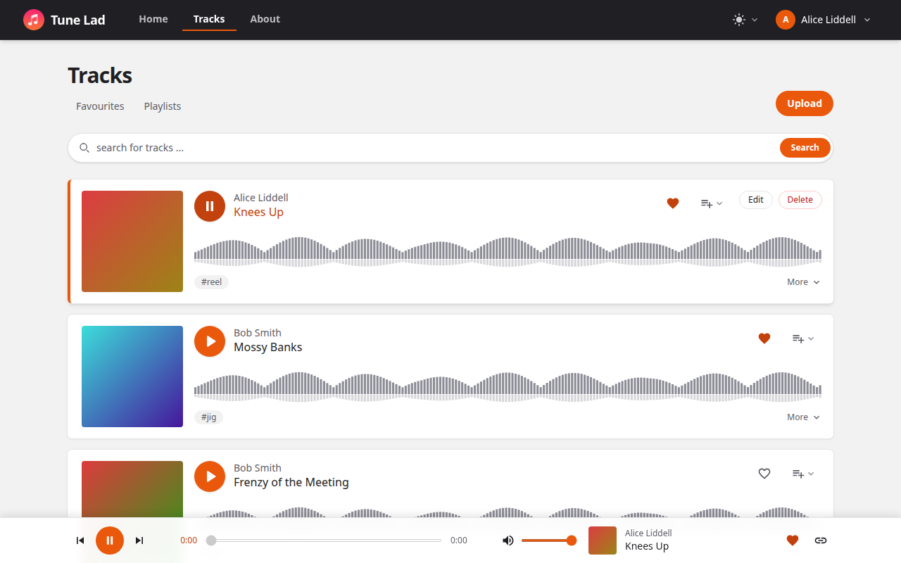
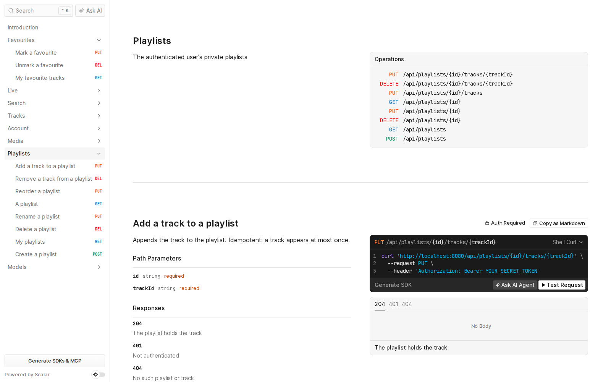
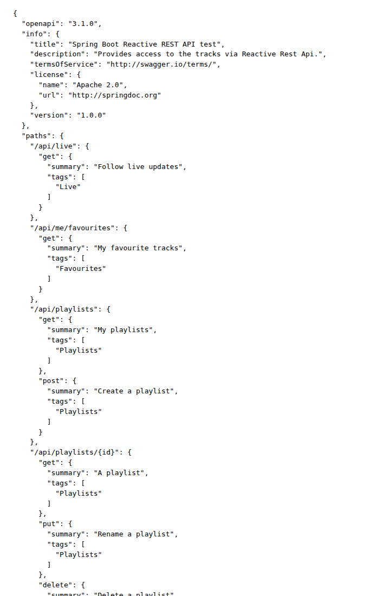

= Tune Lad (playground)
//:doctype: book
:sectnums:
//:source-highlighter: highlightjs
:idprefix:
:idseparator: -
:sectlinks:
:sectanchors:
//:linkcss: false
:allow-uri-read:
// :imagesdir: ./doc/images

:icon-party: &#x1F973;

ifndef::env-github[:icons: font]
ifdef::env-github[]
:status:
:outfilesuffix: .adoc
:caution-caption: :fire:
:important-caption: :exclamation:
:note-caption: :paperclip:
:tip-caption: :bulb:
:warning-caption: :warning:
endif::[]
// Vars
:project-group-id: org.tunelad
:project-artifact-id: tunelad
:project-version: 0.0.1-SNAPSHOT
:orga: uguy
:uri-org: https://github.com/{orga}
:uri-repo: {uri-org}/{project-artifact-id}
:uri-issues: {uri-repo}/issues
:uri-contributors: {uri-repo}/graphs/contributor
:uri-rel-file-base: link:
:uri-rel-tree-base: link:
ifdef::env-site,env-yard[]
:uri-rel-file-base: {uri-repo}/blob/master/
:uri-rel-tree-base: {uri-repo}/tree/master/
endif::[]
:uri-changelog: {uri-rel-file-base}CHANGELOG.adoc
:uri-contribute: {uri-rel-file-base}CONTRIBUTING.adoc
:uri-license: {uri-rel-file-base}LICENSE

ifdef::status[]
image:{uri-repo}/actions/workflows/workflow-build.yml/badge.svg?branch=main[Build,link="{uri-repo}/actions?query=workflow%3Aworkflow-build+branch%3Amain"]
image:https://img.shields.io/badge/License-GPL%20v3-yellow.svg[License,link="{uri-license}"]
endif::[]

Dummy project used as a playground for things like https://docs.spring.io/spring-modulith/docs/current/reference/html/[Spring Modulith], https://docs.spring.io/spring-framework/docs/current/reference/html/web-reactive.html[WebFlux], https://swagger.io/specification/[OpenAPI], https://kit.svelte.dev/docs/introduction[SvelteKit], https://tailwindcss.com/[Tailwind CSS], etc.

This simple app allows to store an mp3 file with some description and play it via the browser `<audio>` html element.

'''

== Features

* Log in with an OpenID Connect provider (Keycloak locally, Google optional); API clients use bearer access tokens
* Upload a track from the UI or the API (mp3, m4a, ogg, flac or wav, up to 100 MB; requires login or a bearer token), with progress, cancel and retry; every track shows who uploaded it
* Owners edit and delete their own tracks, and administrators (Keycloak `admin` role) any track, from the API or the track list
* List tracks and search them by words in title or description (a new upload becomes searchable within a few seconds)
* Play track from browser (streaming bytes with range support, so the player can seek), in a player bar that stays
  at the bottom of the screen across pages: play/pause, previous/next through the track list, seeking, volume and
  mute (remembered between visits)
* Track waveforms: computed with ffmpeg shortly after upload (and backfilled at startup for older tracks), served on
  `GET /api/tracks/{id}/waveform`, and drawn on each track of the list, where a click seeks within the track
* Share a link that starts a track at a given time (`/tracks?play=<id>&t=<seconds>`)
* OpenAPI v3 endpoint
* Spring boot actuator features (health, info, etc.)
* Mobile friendly
* PWA support
* Lighthouse score follow up

== Developing

=== Prerequisite

- a git client
- a java (jdk25 or later)
- maven (optional if you choose to use https://github.com/takari/maven-wrapper[maven wrapper script])
- Docker and Docker Compose
- NodeJS v24.11.1 (npm v11.6.2) or later
- https://ffmpeg.org[ffmpeg] on the `PATH` (check with `ffmpeg -version`; e.g. `sudo apt install ffmpeg`), to compute
  track waveforms. The backend tests need it. Without it the app still runs, but waveforms stay pending until it is
  installed and the app restarted. Another location can be set with `tunelad.media.ffmpeg.path`.

=== Building

==== Backend

This is a standard maven project. To build the application as fat jar, simply execute:

[source,bash,subs="attributes"]
----
git clone {uri-repo}.git
cd {project-artifact-id}/
./mvnw package
----

The build should produce under the `target/` folder (and in your local maven repository) a jar archive named `{project-artifact-id}-{project-version}.jar`

For more details about apache maven, please refer to the https://maven.apache.org/guides/getting-started/[documentation]

==== Tests

`./mvnw clean verify` runs every test: the Java tests (Testcontainers, so Docker must be running), the frontend unit tests (vitest) in the `test` phase, and the Playwright e2e tests in the `integration-test` phase.
The e2e tests run against the static frontend build with the REST API mocked, so they need neither the backend nor MongoDB.
The first build downloads Chromium for Playwright (cached in `~/.cache/ms-playwright`).

Use the usual maven flags to skip tests:

[source,bash]
----
./mvnw verify -DskipITs    # skip the frontend e2e tests only
./mvnw verify -DskipTests  # skip all Java and frontend tests
----

From the `app/` folder, `npm run test:unit` and `npm run test:e2e` run each frontend suite on its own.

==== Frontend

The frontend source code lives in `<project root>/app` folder.

Svelte frontend is build during maven backend build but if your want livereload for UI development this command will run the frontend app in dev mode.

[source,bash,subs="attributes"]
----
npm run dev -- --open
----

You should format frontend resource by running the following command (todo: make this a git commit hook).

[source,bash,subs="attributes"]
----
npm run format
----

== Running the application

=== Prerequisite

The application depends on MongoDB. You can start an instance by running docker compose from the root folder.

[source,bash,subs="attributes"]
----
docker compose up -d
----

MongoDB runs as a single-node replica set (`rs0`), because the application uses MongoDB transactions, which
need one. The replica set is initiated by the container healthcheck on first start; `docker compose up -d --wait`
returns once it is ready.

Mongo Express (a MongoDB web UI) should be available at http://localhost:8081

=== Keycloak (local login)

Users log in through an OpenID Connect provider. Locally, Keycloak stands in for Google and friends: `docker compose up -d`
starts it on http://localhost:8180 and imports the `tunelad` realm from `docker/keycloak/tunelad-realm.json`.
The application needs Keycloak running to start, because it reads the provider's configuration at startup.

[cols="1,1,2"]
|===
|User |Password |Display name

|`alice` |`alice` |Alice Liddell
|`bob` |`bob` |Bob Smith
|`admin` |`admin` |Tune Lad Admin, with the realm role `admin`: may edit and delete any track
|===

The realm puts its realm roles in a `roles` claim of the tokens, and the application treats a user holding the `admin`
role as an administrator (`GET /api/me` answers `"admin": true`).

The Keycloak admin console is at http://localhost:8180/admin (`admin`/`admin`). That `admin` is Keycloak's own
administrator in the `master` realm, unrelated to the `admin` user of the `tunelad` realm who logs in to the app.

Keycloak imports the realm only when it doesn't exist yet. After changing `docker/keycloak/tunelad-realm.json` (or
pulling a change to it), recreate the container to import it again (Keycloak keeps its data inside the container):

[source,bash]
----
docker compose up -d --force-recreate keycloak
----

WARNING: The realm is for local development only: the `tunelad` client secret (`tunelad-dev-secret`) is committed, and
direct access grants are enabled so that curl and tests can get tokens with a username and password.

Log in from the browser at http://localhost:8080/login, which lists the configured providers, also available as JSON from `GET /api/login-providers`.

To also offer Google, create an OAuth client in the Google Cloud console with the authorized redirect URI
`http://localhost:8080/login/oauth2/code/google`, then run the application with the `google` profile and the client's
credentials:

[source,bash]
----
GOOGLE_CLIENT_ID=... GOOGLE_CLIENT_SECRET=... ./mvnw spring-boot:run -Dspring-boot.run.profiles=google
----

The same person logging in through Keycloak and through Google gets two separate accounts.

To check that the realm is up and get an access token for alice:

[source,bash]
----
curl -s http://localhost:8180/realms/tunelad/.well-known/openid-configuration
curl -s -d grant_type=password -d client_id=tunelad -d client_secret=tunelad-dev-secret \
  -d username=alice -d password=alice http://localhost:8180/realms/tunelad/protocol/openid-connect/token
----

To wipe the local data (tracks, audio and search index) and start from an empty database, remove the containers
together with their volumes:

[source,bash,subs="attributes"]
----
docker compose down -v
----

NOTE: Every track has an owner since user accounts were added. Tracks stored by an earlier version have none and are
not migrated: wipe the local data once when upgrading past that change.

=== Uploading a track

Logged-in users upload from the *Upload* link on the tracks page, which shows the upload's progress and lets them
cancel it or retry after a failure. Uploads also work through the REST API (or Scalar), authenticated with an access
token. Listing, searching and playing tracks need no login. For example, as alice, with the application and Keycloak
running:

[source,bash]
----
TOKEN=$(curl -s -d grant_type=password -d client_id=tunelad -d client_secret=tunelad-dev-secret \
  -d username=alice -d password=alice http://localhost:8180/realms/tunelad/protocol/openid-connect/token \
  | sed 's/.*"access_token":"\([^"]*\)".*/\1/')
curl -i -H "Authorization: Bearer $TOKEN" \
  -F title="Knees Up" -F description="A reel and a song" -F file=@src/test/resources/mp3/Knees_Up.mp3 \
  http://localhost:8080/api/tracks
----

The response is `201 Created`, with the stored track as its JSON body and its URL in the `Location` header. The track
is stored with alice as its owner. The audio format comes from the file name's extension: mp3, m4a, ogg, flac or wav.
Other files are rejected with 415 Unsupported Media Type, files over 100 MB with 413 Content Too Large, a missing or
blank title or description with 400 Bad Request, and an upload without a token with 401 Unauthorized.

=== Editing and deleting a track

The owner of a track, or an administrator, can replace its metadata (title, description, artist, album: an omitted
artist or album is cleared) or delete it with its audio, from the track list or the API. Anyone else gets 403
Forbidden. Continuing with alice's token from above:

[source,bash]
----
ID=$(curl -s 'http://localhost:8080/api/tracks' | sed 's/.*"id":"\([^"]*\)","title":"Knees Up".*/\1/')
curl -X PUT -H "Authorization: Bearer $TOKEN" -H 'Content-Type: application/json' \
  -d '{"title":"Knees Up (live)","description":"Recorded at Celtic Connections","artist":"Breabach"}' \
  http://localhost:8080/api/tracks/$ID
curl -X DELETE -H "Authorization: Bearer $TOKEN" http://localhost:8080/api/tracks/$ID
----

Search shows the change within a few seconds.

== Configuration

=== MongoDB database

MongoDB configuration lives in the `application.yml` file. `Track` documents are stored in a regular collection named `tracks` by the `track` module. Audio files belong to the `media` module: on upload, `track` hands the audio stream to `media`, which stores it in MongoDB GridFS under the track id and serves it to the player (`GET /api/tracks/{id}/play`, with byte ranges).

Search follows CQRS: the `search` module keeps its own read model, the `search_tracks` collection with a MongoDB full-text index, and fills it from the `NewTrackSaved` events that the `track` module publishes. Events go through the Spring Modulith Event Publication Registry (the `event_publication` collection), and are delivered once the upload's MongoDB transaction has committed.

[source, yaml]
----
spring:
    mongodb:
    database: 'tunelad'
    password: 'tunelad'
    username: 'tunelad'
    authentication-database: 'admin'
    host: 'localhost'
    port: 27017
----

== UI

=== Tune Lad

Application is available at http://localhost:8080

You can load some samples, uploaded as alice, by running the import methods of the (disabled) test class `org.tunelad.ImporterTest` xref:src/test/java/org/tunelad/ImporterTest.java[src/test/java/org/tunelad/ImporterTest.java].

=== Scalar UI and OpenAPI

Scalar UI is available at http://localhost:8080/scalar

OpenAPI spec is available at http://localost:8080/v3/api-docs

== Getting Help

The *{orga}* organization on GitHub hosts the project's source code, issue trackers, and other projects.

Source repository (git):: {uri-repo}
Issue tracker:: {uri-issues}
Organization on GitHub:: {uri-org}

== Copyright and License

Use of this software is granted under the terms of the GNU GENERAL PUBLIC LICENSE.

See the {uri-license}[LICENSE] for the full license text.

== Links

- Project homepage: {uri-org}/{project-artifact-id}/
- Repository: {uri-org}/{project-artifact-id}/
- Issue tracker: {uri-org}/{project-artifact-id}/issues. +
